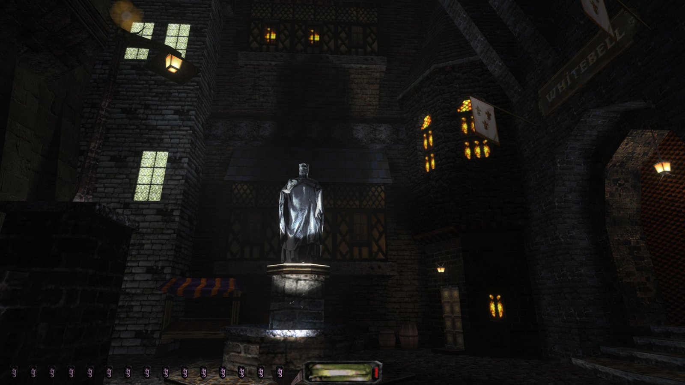
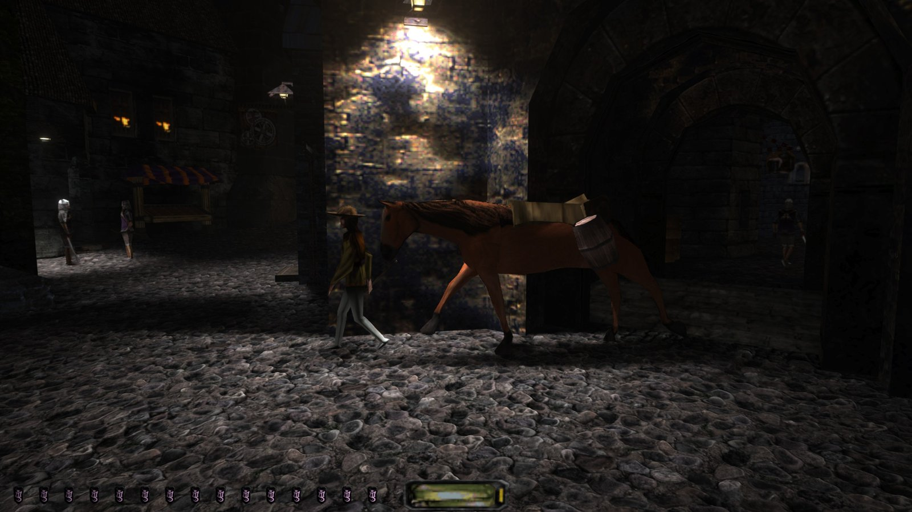
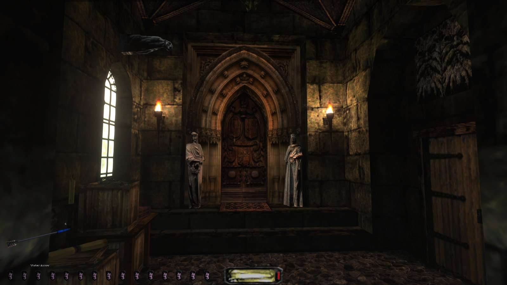
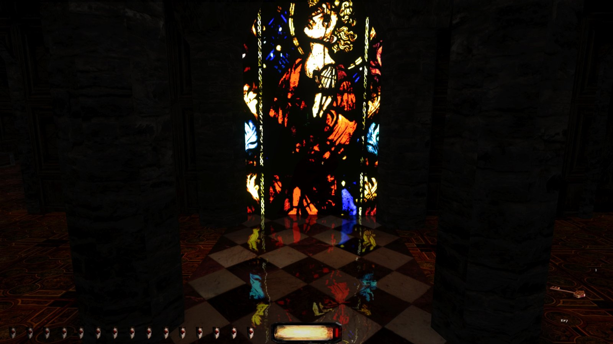
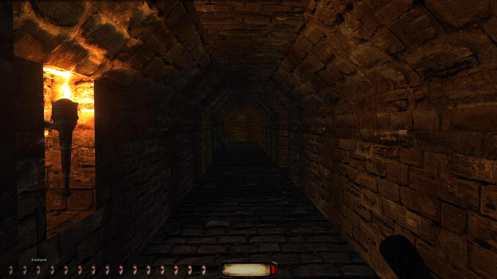
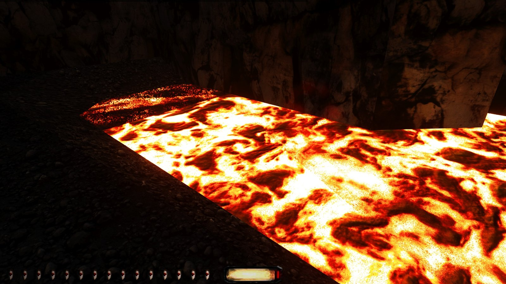

# Thief RT for Mac

**Thief Gold, Thief II: The Metal Age and their fan missions (The Black Parade included), path traced and running natively on Apple silicon Macs.**

Thief RT is the open-source restoration of Looking Glass's Dark Engine, ported to macOS, with a Metal path tracer (RTGL1) and an OpenGL renderer. No Wine, CrossOver or virtual machine: it's a native arm64 app.

| | |
|---|---|
|  |  |
|  |  |
|  |  |

## Download

**[Latest release (DMG)](https://github.com/loui1989/thief-rt-mac/releases/latest)**. Open it, read *Read Me*, and run *Install Thief RT*.

The app isn't notarised: the first time, macOS refuses to open it. Go to **System Settings → Privacy & Security**, scroll down and click **Open Anyway**.

## What you need

- A Mac with Apple silicon (M1 or later). For ray tracing an M3 or later is recommended (hardware ray tracing).
- macOS 14 or newer.
- Your own copy of the games: **Thief Gold** (or Thief: The Dark Project) and/or **Thief II: The Metal Age**, from Steam or GOG. They are not included. Copy the game's folder from a Windows install, or unpack the GOG installer with `innoextract`.

## Features

- **Path tracing** (RTGL1 on Metal): ray-traced lighting, shadows, reflections, bounce light and god rays, with MetalFX upscaling.
  Quality presets Ultra / High / Medium / Low; dynamic resolution keeps 60 fps. About 60 fps on High (1800p) on an M3 Max.
- **OpenGL renderer** for any Apple silicon Mac: the game's own look with sharper textures, real-time torch and lamp light with shadows, bump maps, an internal-resolution setting and unlocked frame rate.
- **Thief Gold and Thief II HD Mod** support: materials (normal and roughness) are made from the textures the first time you play each level, with Thief II's own surfaces (marble floors, parquet, wallpaper, stained glass, the Mechanists' iron) recognised too.
- **Fan missions** from the game's `FMs` folder, The Black Parade first.
- A **launcher** (game, campaign or fan mission, renderer, quality, OpenGL options) and an **installer** that finds your games and offers to set up The Black Parade and the HD Mod.
- In game, **Cmd+,** or **F10** opens the graphics settings.

### Optional: the Thief Gold HD Mod

Hand-made HD textures, models and skies for Thief Gold. Download the full installer (`Thief1HDMod1.2.exe`) into your Downloads folder and the Thief RT installer finds it and sets it up (it needs `innoextract`: `brew install innoextract`). An `HDMOD` folder copied from a Windows install works too.

- ModDB: https://www.moddb.com/mods/thief-gold-hd-texture-mod
- Nexus Mods: https://www.nexusmods.com/thiefthedarkproject/mods/1

### Optional: the Thief II HD Mod

The same author's HD Mod for Thief II (version 1.0): HD textures, objects, skies and water. Put its full installer in Downloads too; the installer (or the launcher's *File → Find Games Again*) finds it and installs it into Thief II's folder (about 5 GB; also needs `innoextract`).

- ModDB: https://www.moddb.com/mods/thief-2-hd-texture-mod
- Nexus Mods: https://www.nexusmods.com/thief2/mods/5

## Building from source

`setup.sh` builds everything on an Apple silicon Mac with Xcode's command line tools: it downloads and builds SDL2, libpng, Squirrel, Ogg Vorbis, FFmpeg and OpenAL Soft into `deps/`, then the engine (`src/`) into `Thief RT.app`.

```
bash setup.sh          # build (again: only what changed)
bash run.sh            # play, with the log in logs/thief.log (--gl: the OpenGL renderer)
bash package/make-dmg.sh   # the disk image, in dist/
```

The path tracer is RTGL1's Metal port (see [loui1989/RayTracedGL1](https://github.com/loui1989/RayTracedGL1)) with Thief's changes in `patches/rtgl1-lib`. `setup.sh` builds it from `rtgl1-kit/src/RayTracedGL1` (with SPIRV-Cross and glslang in `rtgl1-kit`) into `rt/bin`; without it, the engine is built with the OpenGL renderer only. The path tracer's run-time files (`rt/`) are also in the release's installer.

## Layout

- `src/`: the engine (the restored Dark Engine with the macOS platform layer, the RTGL1 path tracer backend and the OpenGL renderer), with its history.
- `patches/rtgl1-lib/`: changes to RTGL1 for Thief.
- `package/`: the launcher (AppKit), the installer, the Read Me, credits and `make-dmg.sh`.
- `setup.sh`, `run.sh`: build and run.

## Disclosure

This port was made with an AI coding assistant (Claude, by Anthropic), directed and tested by me. The engine restoration it builds on is AI-assisted too (see `src/README.md`).

## Credits

The Dark Engine restoration (its contributors) · RTGL1 path tracer (Sultim Tsyrendashiev) · Steam Audio (Valve) · SDL, OpenAL Soft, FFmpeg, Ogg Vorbis, libpng, Squirrel · Thief: The Dark Project, Thief Gold and Thief II (Looking Glass Studios; now Square Enix) · The Thief Gold and Thief II HD Mods (Bentraxx Productions) · The Black Parade and the other fan missions (their authors). Details: `package/CREDITS.txt`.

Thief is a trademark of its owners. This project is not made or endorsed by them, and contains none of the games' data.

## Licence

The engine is under its MIT-style licence (`src/LICENSE.md`); the scripts, launcher and installer here are under the same terms. RTGL1 is MIT. The libraries keep their own licences (listed in `package/CREDITS.txt`).
